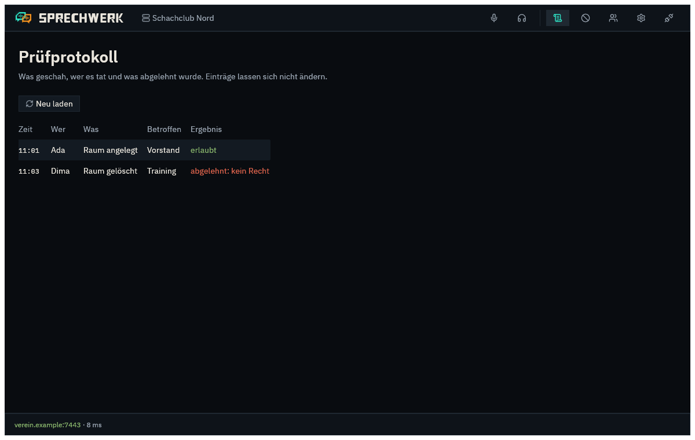

# sprechwerk

**Sprach- und Texträume für Vereine.** Selbst gehostet, ein Container, ein
UDP-Port. Für Leute, die heute TeamSpeak oder Discord benutzen, und einen
Betreiber, der die Daten selbst in der Hand haben will.


> Arbeitstitel. Der Name ist austauschbar; Verzeichnis und Crates heißen so,
> bis ein besserer gefunden ist.

**Inhalt:** [Was es ist](#was-es-ist) · [Für wen](#für-wen) ·
[So sieht es aus](#so-sieht-es-aus) · [Im Vergleich](#warum-nicht-einfach-teamspeak-weiter) ·
[Stand](#stand-heute) · [Installation](#installation) ·
[Erstes Verbinden](#das-erste-mal-verbinden) · [Sicherheit und Daten](#sicherheit-und-daten) ·
[Betrieb](#betrieb) · [Selbst prüfen](#selbst-prüfen) · [Mitentwickeln](#mitentwickeln)

## Was es ist

Ein Ort zum Reden und Schreiben für eine geschlossene Gruppe: Vorstandssitzung,
Trainingsabend, Spieleabend, Elternabend. Man tritt einem Server bei, betritt
einen Raum, spricht — und kann daneben Text schreiben, der bleibt.

Der Unterschied zu den üblichen Werkzeugen ist nicht der Funktionsumfang,
sondern die Bauweise: **ein Datenmodell, aus dem alles folgt** (Räume, Rollen,
Rechte, Anzeige), **ein Port** statt dreier, **keine Konten**, sondern ein
Schlüssel, und **jede Entscheidung mit Begründung und Preis** in
[`SPEC.md`](SPEC.md) und [`docs/adr/`](docs/adr/).

## Für wen

| Lage | Was sprechwerk dafür tut |
|---|---|
| Verein mit 20–200 Leuten, ein Server beim Betreiber oder auf einem gemieteten Root-Server | ein Container, ein Volume, ein UDP-Port — kein Reverse-Proxy, kein Zertifikatsantrag |
| Verein mit Datenschutzauflage (Mitgliederdaten, Protokolle) | Sprache je Raum Ende-zu-Ende-verschlüsselt; der Betreiber kann nicht mithören |
| Vorstand, der nachweisen muss, wer was getan hat | Prüfprotokoll im Fenster: wer, wann, was, vorher/nachher — auch abgelehnte Versuche |
| Leute, die kein Konto anlegen wollen | Kennung ist eine Schlüsseldatei; mitnehmen = derselbe Mensch auf dem neuen Gerät |

Nicht gedacht für: Firmen mit zehntausenden Gleichzeitigen, offene Communitys
mit Fremden, Browser-Sofortnutzung ohne Installation.

## So sieht es aus

Drei Farbschemata — **dark**, **light**, **mono** —, vier Sprachen (de, en,
es, fr), vollständig per Tastatur bedienbar.

| dark | light |
|---|---|
|  |  |
|  |  |
|  |  |

Weitere Ansichten (Sperrliste, Einstellungen) und alle Bilder in **mono** liegen
in [`docs/bilder/`](docs/bilder/).

Die Bilder sind **erzeugt**, nicht abgelegt: `npm --prefix ui run bilder` startet
die Oberfläche mit dem eingebauten Klickdummy (kein Server, keine Soundkarte),
klickt sich durch alle Ansichten und nimmt jede in allen drei Schemata auf —
mit fester Uhrzeit, deshalb liefert jeder Lauf auf derselben Maschine dieselben
Bytes. Dabei prüft es im echten Browser, was ein Test ohne Browser nicht sieht
(etwa, dass jeder Name in der Raumliste sichtbar ist).

Was das Fenster anders macht als TeamSpeak:

* **Prüfprotokoll** mit vorher/nachher und **abgelehnten** Versuchen.
* **Sperrliste** — wer, warum, von wem, mit Knopf zum Aufheben.
* **Schlüsselstand je Raum** — fehlt der Ende-zu-Ende-Schlüssel, steht dort
  „du hörst nichts" mit einem Knopf zum Nachfordern, statt Stille ohne Grund.
* **Qualität in der Statuszeile** — verlorene Rahmen als Zahl, Umlaufzeit in
  Millisekunden, nicht als Symbol.
* **Eigene Kennung** in Vierergruppen, mit Hinweis, was man weitergeben darf.
* **Zertifikat des Servers** sichtbar, Zeichen für Zeichen vergleichbar mit dem,
  was der Server beim Start anzeigt.

## Warum nicht einfach TeamSpeak weiter

TeamSpeak 3 tut seit 2006, was es soll. Es wird aber nicht dadurch unordentlich,
dass Funktionen fehlen, sondern durch das, was drumherum gewachsen ist. Vier
Dinge, die dieses Projekt anders macht:

1. **Ein Modell statt verstreuter Zustände.** Zustände sind Summentypen
   (`Zustand { Leer, Laedt, Fertig(Daten), Fehler(Text) }`), die Oberfläche ist
   `render(modell)`. Eine Ansicht, die etwas versteckt, das im Modell sichtbar
   ist, wäre ein Fehler — nicht eine Einstellung.
2. **Rechte, die man lesen kann.** Vier Rollen und eine Tabelle im Programm
   statt ein paar hundert Einzelrechte mit Vererbung über den Raumbaum.
3. **Ein Port und keine eigene Krypto.** QUIC bringt TLS 1.3 mit; wir schreiben
   keine Verschlüsselung, wir benutzen eine. Steuerung und Text laufen als
   Strom, Sprache als Datagramm — alles auf demselben UDP-Port.
4. **Nachvollziehbarkeit statt Gefühl.** Jede Zusage hat eine Messung
   (`scripts/latenz.sh`, `scripts/sprechprobe.sh`, [`docs/QUALITAET.md`](docs/QUALITAET.md))
   und jede Festlegung einen Preis in `SPEC.md`.

### Im Vergleich

| | TeamSpeak 3 | sprechwerk |
|---|---|---|
| Lizenz | proprietär; kostenlose Lizenz mit begrenzter Platzanzahl, Lizenzdatei nötig | MIT, keine Platzgrenze, keine Lizenzdatei |
| Quellcode | geschlossen (Client und Server) | offen: Server, Client, Protokoll, Oberfläche |
| Ports | UDP 9987 Sprache, TCP 10011 Abfrage, TCP 30033 Dateien | **ein** UDP-Port (QUIC) |
| Verschlüsselung | eigene Krypto zwischen Client und Server; der Server kann Sprache entschlüsseln | TLS 1.3 mit angeheftetem Zertifikat; Sprache je Raum **Ende zu Ende**, hybrid quantensicher im Transport |
| Kennung | dauerhafte UID, kopierbar | Ed25519-Besitznachweis je Verbindung, mitnehmbare Schlüsseldatei |
| Rechte | einige hundert Einzelrechte, Vererbung | vier Rollen, feste Tabelle |
| Protokoll | binär, nicht dokumentiert (nachgebaut) | JSON-Rahmen, längenpräfixiert, versioniert (`SPEC.md` §7, `docs/`) |
| Oberfläche | Windows/macOS/Linux; Mobil-App kostenpflichtig | Fenster (Tauri 2, Linux/Windows/macOS), drei Farbschemata, vier Sprachen; Browser später über WebTransport |
| Text | dauerhaft, serverseitig gespeichert | dauerhaft, serverseitig — bewusst, damit Suche und Moderation möglich bleiben |
| Dateien, Status, Video, Plugins | vorhanden (teils seit Jahren) | **nicht vorhanden** — bewusst „später", nicht „gestrichen" |
| Betriebswerkzeug | Abfrage-Schnittstelle, Hoster-Panels | Datei + Umgebungsvariablen + Unterbefehle (`beispiel`, `export`, `import`, `sicherung`, `--gesundheit`) |
| Prüfprotokoll im Client | nein | ja, für Administrator und Moderator |
| Reife | 20 Jahre, großes Ökosystem | 0.1, ein Projekt, ein Maintainer |

**Was TeamSpeak besser kann** — und was wir nicht kleinreden: Mobile Apps für
iOS und Android, Dateitransfer im Client, eine Plugin-Schnittstelle, etabliertes
Hosting bei vielen Anbietern, und zwei Jahrzehnte Fehler, die schon gefunden
sind. Wer das braucht, ist mit TeamSpeak heute besser dran. Ein
Latenzvergleich mit demselben Ton steht noch aus (`docs/QUALITAET.md` §1).

Angaben zu TeamSpeak stammen aus dessen öffentlicher Dokumentation und
Lizenzbedingungen (Stand 2026) und können sich ändern.

## Stand heute

Lauffähig und geprüft: **211 Tests** im Arbeitsbereich, **36** in der
Fensteranwendung, **52** in der Oberfläche, dazu die Ansichten im echten
Browser und sechs Messskripte, die einen echten Server starten.

* **Sprache** — Aufnahme über PipeWire/PulseAudio, Hochpass, Entrauschung,
  Noisegate, Echounterdrückung (AEC3, reines Rust), Opus 32 kbit/s, 60 ms
  Vorlauf gegen abgeschnittene erste Wörter, Jitter-Puffer je Sprecher, Mischen
  im Client. Der Server verteilt nur und prüft das Rederecht — er mischt nichts.
  Durchlauf durch den Server p99 **21–29 µs**, Beitritt p95 **1,8–2,8 ms**
  (`scripts/latenz.sh`, [`docs/QUALITAET.md`](docs/QUALITAET.md) §2d).
* **Text** — Verlauf, Löschen (Verfasser weich, Moderator hart),
  Aufbewahrungsfrist, Sicherung als lesbares JSON.
* **Rollen und Rechte** — Administrator, Moderator, Mitglied, Gast; Prüfprotokoll
  für jede Änderung, Sperrliste mit Grund.
* **Verschlüsselung** — TLS 1.3 über QUIC mit angeheftetem Zertifikat (TOFU),
  Ende-zu-Ende je Raum für Sprache (ChaCha20-Poly1305, Gruppenschlüssel mit
  Epoche), Transport hybrid quantensicher (`X25519MLKEM768`).
* **Betrieb** — ein Container, ein Volume, Sicherung nach Plan, Healthcheck über
  ein Lebenszeichen, Unterbefehle für Export/Import/Sicherung.

Noch nicht gebaut (bewusst): Dateien, Status/Abwesenheit, Video,
Bildschirmfreigabe, Emojis/Reaktionen, Suche. Was als Nächstes kommt, steht in
[`SPEC.md`](SPEC.md) §11 und [`docs/adr/0010-quantensicherheit.md`](docs/adr/0010-quantensicherheit.md)
(Schritt 2: Raumschlüssel hybrid und mit Forward Secrecy).

## Installation

Zwei Teile: der **Server** (einmal, beim Betreiber) und das **Fenster** (bei
jedem, der mitredet).

### Fertige Pakete

Jedes [Release](https://github.com/patimweb-labs/sprechwerk/releases) bringt mit:

| Datei | Für |
|---|---|
| `Sprechwerk_<version>_amd64.deb` | Fenster — Debian, Ubuntu (ab 24.04) |
| `Sprechwerk-<version>-1.x86_64.rpm` | Fenster — Fedora, openSUSE |
| `Sprechwerk_<version>_amd64.AppImage` | Fenster — jedes andere Linux, ohne Installation |
| `sprechwerk-server-<version>-linux-x86_64.tar.gz` | Server + `sprechwerk-cli`, PC/Server |
| `sprechwerk-server-<version>-linux-aarch64.tar.gz` | dasselbe für ARM (Raspberry Pi 4/5, 64 Bit) |
| `SHA256SUMS` | Prüfsummen aller Dateien (`sha256sum -c SHA256SUMS`) |

Dazu das Container-Abbild für `amd64` und `arm64`:

```bash
docker run -d --name sprechwerk -p 7443:7443/udp -v sprechwerk-daten:/data \
  ghcr.io/patimweb-labs/sprechwerk:latest
```

`.deb` und `.rpm` ziehen Opus und `parec`/`pacat` als Abhängigkeit nach; beim
AppImage müssen beide vorhanden sein (auf fast jedem Linux-Schreibtisch sind
sie es). Die Server-Programme brauchen glibc 2.39 oder neuer (Debian 13,
Ubuntu 24.04, aktuelle Fedora) — für ältere Systeme den Container nehmen.
Windows- und macOS-Pakete gibt es noch nicht (siehe [Fenster](#fenster)).

### Server im Container (der übliche Weg)

```bash
docker compose up -d --build
docker compose logs -f          # zeigt den Zertifikat-Fingerabdruck
```

Ohne eigenen Bau: in `docker-compose.yml` die Zeile `build: .` streichen und
`image: ghcr.io/patimweb-labs/sprechwerk:0.1` eintragen. Fest auf eine
Minor-Version statt `latest`: vor 1.0 kommt ein Bruch als neue Minor-Version,
und ein Update migriert die Daten ohne Rückweg (SPEC §2) — das soll ein
bewusster Schritt sein.

Ein Volume (`/data`), ein Port (`7443/udp`), sonst nichts — Einstellungen in
`docker-compose.yml` oder als Umgebungsvariablen (siehe [Betrieb](#betrieb)).
In der Firewall nur **UDP** 7443 freigeben; TCP braucht QUIC nicht.

Mit **Podman**: `podman build --format docker -t sprechwerk .` — im
Standardformat (OCI) verwirft Podman die `HEALTHCHECK`-Anweisung.

Der Container prüft sich über ein Lebenszeichen (`<daten>/lebt`, alle 10 s neu
geschrieben, `sprechwerk --gesundheit` wertet es aus) — **nicht** über eine
Testverbindung: der erste Client wird Administrator, ein Healthcheck darf diesen
Platz nicht belegen.

### Server ohne Container

```bash
cargo build --release -p sprechwerk-server
SPRECHWERK_DATEN=./data ./target/release/sprechwerk
```

Braucht nur Rust (die Fassung legt `rust-toolchain.toml` fest, `rustup` holt sie
selbst) und einen C-Compiler für den TLS-Anbieter (`aws-lc-rs`); `cmake` ist
nicht nötig. `sprechwerk beispiel > sprechwerk.toml` erzeugt eine vollständige
Konfiguration zum Anpassen.

### Fenster

Gebaut wird aus dem Quellbaum; Voraussetzungen auf jeder Plattform: Rust (über
`rustup`), Node.js 22 und die Komponentenbibliothek
[`weppelmann-ui`](https://github.com/Smotherer007/weppelmann-ui) **neben** diesem
Verzeichnis (`../weppelmann-ui`, dort einmal `npm ci && npm run tokens`).

```bash
cd ui && npm ci && cd ..
cargo build --release --manifest-path crates/desktop/Cargo.toml --features custom-protocol
# Programm: crates/desktop/target/release/sprechwerk-desktop
```

`--features custom-protocol` bettet die Oberfläche ein; ohne das Merkmal lädt
das Fenster die Entwicklungsadresse (Port 1423).

Pakete wie im Release (`.deb`, `.rpm`, AppImage) baut `npm --prefix ui run
pakete` — die Tauri-CLI kommt dabei aus `ui/node_modules`, festgelegt auf eine
Version; nichts weiter zu installieren. Ergebnis unter
`crates/desktop/target/release/bundle/`.

**Linux — Fedora** (so geprüft):

```bash
sudo dnf install gcc pkgconf-pkg-config webkit2gtk4.1-devel gtk3-devel \
  libsoup3-devel javascriptcoregtk4.1-devel librsvg2-devel opus pulseaudio-utils
```

**Linux — Debian/Ubuntu** (so in der CI, Ubuntu 24.04):

```bash
sudo apt install build-essential pkg-config libwebkit2gtk-4.1-dev libgtk-3-dev \
  libsoup-3.0-dev libjavascriptcoregtk-4.1-dev librsvg2-dev patchelf \
  libopus0 pulseaudio-utils
```

Ton läuft unter Linux über das vorhandene PipeWire/PulseAudio (`parec`/`pacat`);
ALSA-Entwicklungspakete braucht es nur für `--features cpal`
([`docs/AUDIO.md`](docs/AUDIO.md)).

**Windows 10/11:** Rust mit der MSVC-Werkzeugkette (Visual Studio Build Tools),
WebView2 (in Windows 11 enthalten). Geräte über WASAPI, ohne Zusatzpakete;
`opus.dll` neben `sprechwerk-desktop.exe` legen.

**macOS:** Xcode-Befehlszeilenwerkzeuge (`xcode-select --install`), Opus z. B.
über `brew install opus`. Geräte über CoreAudio.

Windows und macOS sind vom Code her vorgesehen (Opus wird zur Laufzeit als
`opus.dll` bzw. `libopus.dylib` geladen, Geräte über `cpal`), laufen aber
**noch nicht in der CI** — Rückmeldungen von dort sind willkommen.

## Das erste Mal verbinden

1. Server starten. Er zeigt:

   ```
   Zertifikat-Fingerabdruck (SHA-256):
     51a2:1556:20e3:3bd9:…:eeba:49fe
   ```

2. Im Fenster die Adresse eintragen, verbinden. Der Fingerabdruck wird
   **angeheftet** (wie bei SSH) und ab dann bei jeder Verbindung geprüft. Weicht
   er ab, bricht die Verbindung ab, **bevor** Kennung oder Serverpasswort über
   die Leitung gehen.
3. Der **erste** Client wird Administrator. Wer zuerst kommt, verwaltet — also
   zuerst du, dann die anderen.

Wurde der Server neu aufgesetzt (neues Zertifikat), muss der gemerkte Wert
einmal ausdrücklich vergessen werden: Serverliste → „Zertifikat vergessen" →
neu verbinden.

## Sicherheit und Daten

**Auf der Leitung:** QUIC = TLS 1.3 mit AEAD, Schlüsselwechsel und Forward
Secrecy. Schlüsselvereinbarung hybrid `X25519MLKEM768` — klassisch *und*
quantensicher in einem Handschlag. Gemessener Aufpreis: +50 µs je
Verbindungsaufbau (`docs/QUALITAET.md` §2c).

**Anmeldung:** kein Passwortkonto, sondern ein Ed25519-Schlüsselpaar; der Server
fordert je Verbindung einen Beweis über eine Zufallszahl an. Die Kennung liegt
als Datei auf dem Rechner — wer sie kopiert, ist derselbe Mensch.

**Sprache je Raum Ende zu Ende:** ein Gruppenschlüssel pro Raum und Epoche,
einzeln per X25519-Umschlag verteilt, Rahmen mit ChaCha20-Poly1305. Der Server
sieht Geheimtext und verteilt nur. Beim Verlassen dreht die Epoche — wer geht,
hört nichts mehr.

**Was das nicht leistet:** Text ist serverseitig lesbar (er wird gespeichert —
das ist die Bedingung für Suche, Aufräumen und Moderation). Der Betreiber sieht
Metadaten: wer wann mit wem. Ein Mitglied, das mitschneidet, hat den Schlüssel.
Ein kompromittiertes Gerät ist kompromittiert. Offen und dokumentiert: die
Umlage des Raumschlüssels hat noch keine Forward Secrecy, und Anmeldung wie
Umlage sind klassisch. Die hybride Umlage mit Wegwerfschlüsseln ist gebaut und
geprüft, aber noch nicht verdrahtet (`docs/adr/0010-quantensicherheit.md`,
Schritt 2).

**Datenschutz:** Alles liegt beim Betreiber — eine SQLite-Datei und Sicherungen
als lesbares JSON unter `<daten>`, sonst nichts. Keine Telemetrie, keine Cloud,
kein Konto bei uns, keine Verbindung zu Dritten. Gespeichert werden je Mitglied
Anzeigename, öffentlicher Schlüssel, Rolle und „zuletzt gesehen", dazu die Texte
(gelöscht nach der Aufbewahrungsfrist, wenn eine gesetzt ist), das
Prüfprotokoll und die Sperrliste — bei einer Adresssperre mit IP-Adresse.
Sprache wird **nicht** gespeichert. Das Betriebsprotokoll auf der Konsole
(`docker compose logs`) nennt bei jeder Anmeldung die Adresse; wie lange es
aufbewahrt wird, entscheidet der Betreiber.

Im Fenster liegen nur die eigene Schlüsseldatei, die gemerkten Server mit ihren
Fingerabdrücken und die Einstellungen — darin, wenn man es so will, das
Serverpasswort. Schlüsseldatei und Einstellungen sind unter Linux und macOS nur
für den eigenen Benutzer lesbar (0600, schon beim Anlegen); unter Windows schützt
sie das Benutzerprofil. Keine Secrets im Code; die Konfiguration kommt aus Datei
und Umgebung.

## Betrieb

Konfiguration über `sprechwerk.toml` (Pfad: `SPRECHWERK_KONFIG`), jeder Wert auch
als Umgebungsvariable — `sprechwerk beispiel` gibt eine vollständige Vorlage aus.

| Datei | Umgebung | Bedeutung |
|---|---|---|
| `server.name` | `SPRECHWERK_NAME` | Anzeigename |
| `server.port` | `SPRECHWERK_PORT` | UDP-Port (Vorgabe 7443) |
| `server.bind` | `SPRECHWERK_BIND` | Adresse (Vorgabe `0.0.0.0`) |
| `server.passwort` | `SPRECHWERK_PASSWORT` | leer = offen |
| `server.standard_rolle` | `SPRECHWERK_STANDARD_ROLLE` | Rolle neuer Mitglieder (`mitglied`, oder `gast` für zu) |
| `server.daten` | `SPRECHWERK_DATEN` | Datenverzeichnis (Vorgabe `/data`) |
| `server.aufbewahrung_tage` | `SPRECHWERK_AUFBEWAHRUNG_TAGE` | Texte nach so vielen Tagen löschen; 0 = unbegrenzt |
| `server.rahmen_je_sekunde` | `SPRECHWERK_RAHMEN_JE_SEKUNDE` | Steuerrahmen je Verbindung und Sekunde, darüber wird getrennt (Vorgabe 100; Sprache zählt nicht) |
| `server.staukontrolle` | `SPRECHWERK_STAUKONTROLLE` | `bbr` (Vorgabe, gleichmäßiger für Sprache) oder `cubic` |
| `server.sprachpuffer_kib` | `SPRECHWERK_SPRACHPUFFER_KIB` | Sendepuffer für Sprache — klein halten: verwerfen statt anstauen (Vorgabe 64) |
| `server.verbindungen_je_adresse` | — | gleichzeitige Verbindungen je IP-Adresse (Vorgabe 8) |
| `sicherung.aktiv` | `SPRECHWERK_SICHERUNG_AKTIV` | Sicherung nach Plan |
| `sicherung.intervall_minuten` | `SPRECHWERK_SICHERUNG_INTERVALL_MINUTEN` | Abstand (Vorgabe 1440 = täglich) |
| `sicherung.behalten` | `SPRECHWERK_SICHERUNG_BEHALTEN` | Anzahl der Sicherungen (Vorgabe 14) |
| `sicherung.verzeichnis` | `SPRECHWERK_SICHERUNG_VERZEICHNIS` | Ziel der Sicherungen (Vorgabe `<daten>/sicherungen`) |
| — | `SPRECHWERK_LOG` | Protokollstufe, z. B. `sprechwerk=debug` (Vorgabe `sprechwerk=info`) |

Betriebswerkzeuge:

```bash
sprechwerk beispiel             # vollständige Konfiguration ausgeben
sprechwerk export <datei>       # Zustand als lesbares JSON schreiben
sprechwerk import <datei>       # Zustand einspielen (sichert vorher automatisch)
sprechwerk sicherung            # Sofortsicherung
sprechwerk --gesundheit         # Lebenszeichen prüfen (für den Healthcheck)
```

Im Container: `docker compose exec sprechwerk sprechwerk sicherung`. Vor einer
Migration kopiert der Server die Datenbank; ein neueres Format wird abgelehnt
statt halb gelesen.

## Selbst prüfen

```bash
scripts/pruefen.sh              # alles: Form, Werkzeuge, Tests, Ansichten im Browser, Sprachproben
scripts/pruefen.sh --nur-tests  # schnell
scripts/latenz.sh               # p50/p95/p99 durch den Server
scripts/rundlauf.sh             # Server + zwei Clients von Hand
scripts/sprechprobe.sh          # Ton durch den Server, ohne Mikrofon
scripts/audio-ende-zu-ende.sh   # echter Gerätepfad mit virtuellen Geräten
npm --prefix ui run bilder      # alle Ansichten in drei Schemata → docs/bilder/
```

Dieselben Schritte laufen bei jedem Push (`.github/workflows/pruefen.yml`; die
Bilder legt die CI als Artefakt ab), und ein Haken hält vor dem Push an
(`git config core.hooksPath .githooks`).

## Mitentwickeln

Die verbindlichen Regeln stehen in [`AGENTS.md`](AGENTS.md) — für Menschen wie
für Werkzeuge. Das Wichtigste in Kürze:

* **Oberfläche ohne Backend:** `npm --prefix ui run dev` startet sie allein
  (Port 1423, Klickdummy über `?mock=1`). Wer für eine Oberflächenaufgabe einen
  Server oder eine Soundkarte braucht, hat die Grenze falsch gezogen.
* **Keine Farben, Größen oder Abstände im Code**, nur Tokens aus
  `@weppelmann/tokens`; ein Test prüft, dass jedes benutzte Token existiert und
  kein `px` in den Stilen steht.
* **Tests sind Teil der Lieferung** — ein Fix ohne Test ist ein Fix auf Probe.
* **Immer über Branch und Pull Request**, Conventional Commits.
* **Releases macht niemand von Hand.** Nach jedem Merge auf `master` hält
  release-please einen PR „chore: Release x.y.z" aktuell (Versionen,
  `CHANGELOG.md`). Wer ihn mergt, löst das Release aus: Tag, Pakete, Abbild,
  Prüfsummen (`.github/workflows/release.yml`). Ging ein Bau schief: „Run
  workflow" mit dem Tag baut die Dateien neu.

## Aufbau

```
crates/domain    Zustand und Regeln: Räume, Rollen, Rechte, Protokoll — kein Netz
crates/protocol  Sprache auf der Leitung: Rahmen, Nachrichten, Sprachkopf, Fingerabdruck
crates/store     SQLite, Export/Import, Migrationen, Sicherungen
crates/adapters  Netz: QUIC, Anmeldung, Zertifikatsprüfung, Ende-zu-Ende, Klang
crates/audio     Aufnahme/Wiedergabe, Opus, Verlustausgleich
crates/ipc       Vertrag zum Fenster: Befehle, Ereignisse, Modellstand
crates/server    Dienst: Listener, Befehlsausführung, Sicherung, Konfiguration
crates/cli       Referenzclient auf der Kommandozeile
crates/desktop   Fensteranwendung (Tauri 2, eigene Sperrdatei) + ui/ (Vue 3)
```

Richtung der Abhängigkeiten: `domain ← adapters ← ipc ← ui`. `domain` kennt kein
Netz — deshalb sind Rechte, Räume und Verläufe ohne Sockets prüfbar. Mehr in
[`docs/architektur.md`](docs/architektur.md) und
[`docs/datenfluss.md`](docs/datenfluss.md).

## Protokoll in einem Blick

```text
Client                                    Server
  ── QUIC (TLS 1.3 hybrid, ALPN sprechwerk/1) ──►
  ◄── Anforderung { nonce }                 Beweisaufforderung
  ── Hallo { kennung, beweis, name } ──►    Ed25519-Signatur über den Nonce
  ◄── Willkommen { Räume, Mitglieder }      oder Fehler
  ◄──► Rahmen (4 Byte Länge + JSON)         Text, Befehle, Antworten
  ◄──► Datagramme (6 Byte Kopf + Opus)      Sprache, unzuverlässig
```

Der Server öffnet den Steuerstrom, weil ein QUIC-Strom der Gegenstelle erst mit
den ersten Bytes sichtbar wird. Je Verbindung kommt die Antwort auf einen Befehl
vor jeder Meldung, die ein späterer Befehl eines anderen auslöst — der Client
darf sich darauf verlassen (`docs/datenfluss.md` §2). Begleitend: das Handbuch
zu TeamSpeak 3 auf Protokollebene liegt als Nachbardokumentation
(`../fernwerk/docs/handbuch/`), nicht in diesem Repository.

## Lizenz

MIT — siehe [`LICENSE`](LICENSE).
