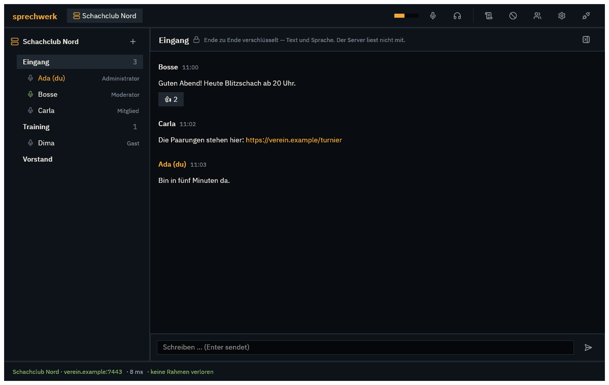
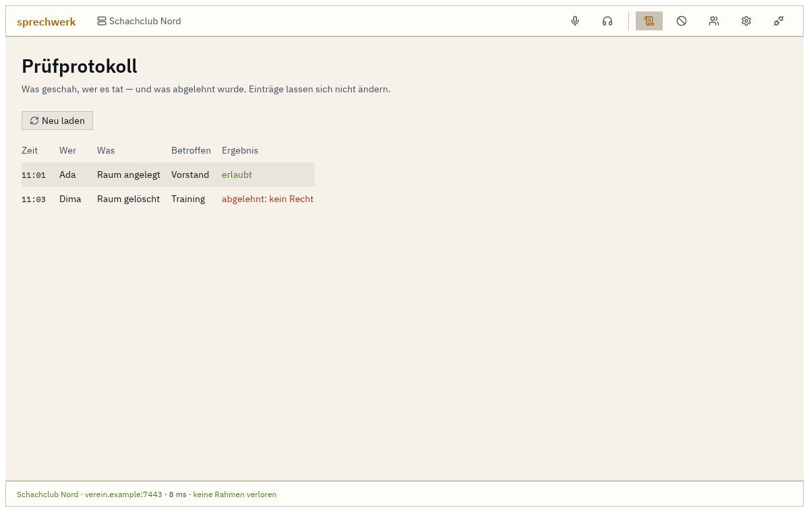
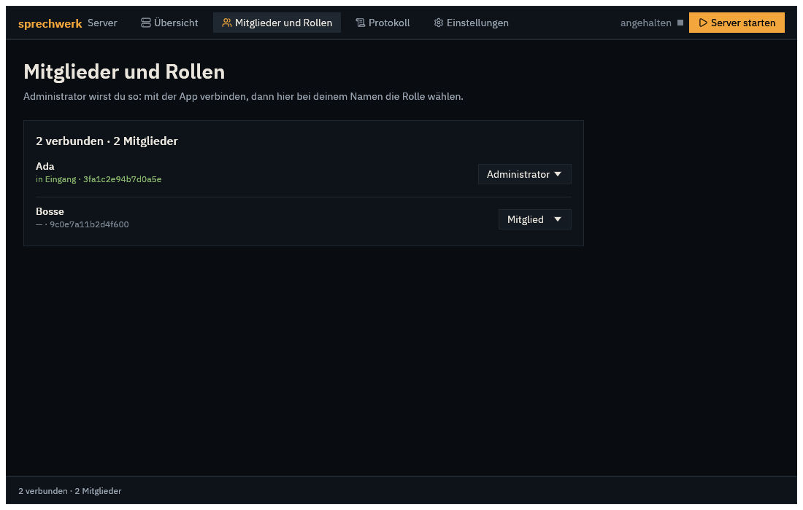

<p align="center">
  <picture>
    <source media="(prefers-color-scheme: dark)" srcset="docs/marke/logo-dark.svg">
    
  </picture>
</p>

# sprechwerk

**Sprach- und Texträume für Vereine.** Selbst gehostet, ein Container, ein
UDP-Port. Für Leute, die heute TeamSpeak oder Discord benutzen — und für einen
Betreiber, der die Daten selbst in der Hand haben will.



> Arbeitstitel. Der Name ist austauschbar; Verzeichnis und Crates heißen so,
> bis ein besserer gefunden ist.

**Inhalt** ·
[Was es ist](#was-es-ist) ·
[Was es kann](#was-es-kann) ·
[Für wen](#für-wen) ·
[So sieht es aus](#so-sieht-es-aus) ·
[Im Vergleich](#im-vergleich) ·
[Stand heute](#stand-heute) ·
[Installation](#installation) ·
[Das erste Mal verbinden](#das-erste-mal-verbinden) ·
[Verwaltung](#verwaltung) ·
[Sicherheit und Daten](#sicherheit-und-daten) ·
[Betrieb](#betrieb) ·
[Selbst prüfen](#selbst-prüfen) ·
[Mitentwickeln](#mitentwickeln) ·
[Aufbau](#aufbau) ·
[Protokoll in einem Blick](#protokoll-in-einem-blick)

## Was es ist

Ein Ort zum Reden und Schreiben für eine geschlossene Gruppe: Vorstandssitzung,
Trainingsabend, Spieleabend, Elternabend. Man tritt einem Server bei, betritt
einen Raum, spricht — und schreibt daneben Text, der bleibt.

Der Unterschied zu den üblichen Werkzeugen ist nicht der Funktionsumfang,
sondern die Bauweise:

* **Ein Datenmodell, aus dem alles folgt.** Räume, Rollen, Rechte und Anzeige
  kommen aus einem Zustand; die Oberfläche ist `render(modell)`. Was im Modell
  sichtbar ist, ist auch zu sehen — „ausblenden" gibt es nicht als Anweisung.
* **Zustände sind Summentypen**, keine Fächer aus Booleans:
  `enum Zustand { Leer, Laedt, Fertig(Daten), Fehler(Text) }`.
* **Ein Port** statt dreier: Steuerung und Text als Strom, Sprache als
  Datagramm, alles auf einem UDP-Port über QUIC.
* **Keine Konten**, sondern ein Schlüsselpaar: die Kennung ist eine Datei, die
  man mitnimmt.
* **Alles Ende zu Ende** — Text, Sprache, Reaktionen, Vorschauen. Der Betreiber
  sieht keinen Inhalt, nur den Betrieb.
* **Jede Festlegung mit Begründung und Preis** in [`SPEC.md`](SPEC.md) und
  [`docs/adr/`](docs/adr/).

## Was es kann

**Sprache.** Räume betreten, reden, hören. Aufnahme über PipeWire/PulseAudio
(Linux), CoreAudio (macOS), WASAPI (Windows). Hochpass, Entrauschung,
Noisegate und Echounterdrückung (AEC3, reines Rust) laufen vor der Kodierung;
Opus mit 32 kbit/s, 60 ms Vorlauf gegen abgeschnittene erste Wörter — die
Sprechtaste schneidet also nichts ab. Je Sprecher ein eigener Jitter-Puffer,
gemischt wird im Client. Der Server verteilt nur, mischt nichts und prüft das
Rederecht. Wer stumm oder taub schaltet, sieht das an sich selbst und an anderen.

**Text.** Ein Chat je Raum, Verlauf dauerhaft. Löschen kann der Verfasser weich
(„Nachricht gelöscht" bleibt stehen), ein Moderator hart; eine Aufbewahrungsfrist
räumt nach Plan auf. Dazu:

* **Reaktionen** — sechs Zeichen (👍 ❤️ 😂 😮 😢 🎉), zusammengefasst angezeigt;
  wer dabei ist, sieht man am Zeichen.
* **Links** — anklickbar und mit **Vorschau**: Titel, Beschreibung und ein
  kleines Bild. Die Seite ruft der **Absender** ab, nie der Empfänger und nie
  der Server; abschaltbar in den Einstellungen. Anklicken öffnet den Browser
  des Systems, nicht das Fenster.

**Rollen und Rechte.** Administrator, Moderator, Mitglied, Gast — vier Rollen
und eine Tabelle statt hunderter Einzelrechte. Kontextmenüs für Eingriffe:
stumm schalten, taub schalten, in einen anderen Raum verschieben, aus dem Raum
werfen, vom Server werfen, sperren. Jede Änderung steht mit vorher/nachher im
**Prüfprotokoll**, auch abgelehnte Versuche; die **Sperrliste** nennt Grund und
Urheber und lässt sich aufheben.

**Verwaltung ohne Browser.** Auf der Konsole (`sprechwerk stand`,
`sprechwerk rolle Ada administrator`, im Container per `docker exec`) oder im
**Server-Fenster**, das den Dienst gleich mitstartet: Serverzustand, Mitglieder
samt Rollen, Live-Protokoll. Hier wird man Administrator, ohne einen Schlüssel
aus der Hand zu geben — siehe [Verwaltung](#verwaltung).

**Betrieb.** Ein Container mit einem Volume und einem UDP-Port — kein
Reverse-Proxy, kein Zertifikatsantrag. Alternativ der Server als Programm unter
Linux, Windows und macOS. Sicherung nach Plan, Export/Import als lesbares JSON,
Healthcheck über ein Lebenszeichen, Unterbefehle für alles, was man in einem
Wartungsfenster braucht.

## Für wen

| Lage | Was sprechwerk dafür tut |
|---|---|
| Verein mit 20–200 Leuten, ein Server beim Betreiber oder auf einem gemieteten Root-Server | ein Container, ein Volume, ein UDP-Port — kein Reverse-Proxy, kein Zertifikatsantrag |
| Verein mit Datenschutzauflage (Mitgliederdaten, Protokolle) | Text und Sprache Ende zu Ende verschlüsselt; der Betreiber kann weder mithören noch mitlesen |
| Vorstand, der nachweisen muss, wer was getan hat | Prüfprotokoll: wer, wann, was, vorher/nachher — auch abgelehnte Versuche |
| Leute, die kein Konto anlegen wollen | Kennung ist eine Schlüsseldatei; mitnehmen = derselbe Mensch auf dem neuen Gerät |

Nicht gedacht für: Firmen mit zehntausenden Gleichzeitigen, offene Communitys
mit Fremden, Sofortnutzung im Browser ohne Installation.

## So sieht es aus

Drei Farbschemata — **dark**, **light**, **mono** —, vier Sprachen (de, en, es,
fr), vollständig per Tastatur bedienbar, Fokus sichtbar, Rollen und Namen
gesetzt.

| dark | light |
|---|---|
|  |  |
|  |  |
|  |  |

Sperrliste, Einstellungen und alle Bilder in **mono** liegen in
[`docs/bilder/`](docs/bilder/).

Die Bilder sind **erzeugt**, nicht abgelegt: die Oberflächentests
(`crates/fenster/tests/oberflaeche.rs`, `egui_kittest`) zeichnen jede Ansicht
mit einem Beispielmodell — ohne Server, ohne Soundkarte — in allen drei
Schemata; mit `SPRECHWERK_BILDER=docs/bilder` landen sie hier. Dieselben Tests
bedienen das Fenster über die Barrierefreiheits-Schnittstelle (AccessKit): ein
Knopf ohne Namen oder ein Zeichen, das keine Schrift darstellen kann, lässt sie
scheitern.

Was das Fenster anders macht als TeamSpeak:

* **Prüfprotokoll** mit vorher/nachher und **abgelehnten** Versuchen.
* **Sperrliste** — wer, warum, von wem, mit Knopf zum Aufheben.
* **Schlüsselstand** — fehlt im eigenen Raum der Sprachschlüssel, steht dort
  „du hörst nichts" mit einem Knopf zum Nachfordern, statt Stille ohne Grund;
  fehlt der Schlüssel für den Chat, sagt das Eingabefeld, worauf es wartet.
* **Qualität in der Statuszeile** — verlorene Rahmen als Zahl, Umlaufzeit in
  Millisekunden, nicht als Symbol.
* **Eigene Kennung** in Vierergruppen, mit Hinweis, was man weitergeben darf.
* **Zertifikat des Servers** sichtbar, Zeichen für Zeichen vergleichbar mit dem,
  was der Server beim Start anzeigt.

## Im Vergleich

TeamSpeak 3 tut seit 2006, was es soll. Es wird aber nicht dadurch unordentlich,
dass Funktionen fehlen, sondern durch das, was drumherum gewachsen ist.

| | TeamSpeak 3 | sprechwerk |
|---|---|---|
| Lizenz | proprietär; kostenlose Lizenz mit begrenzter Platzanzahl, Lizenzdatei nötig | MIT, keine Platzgrenze, keine Lizenzdatei |
| Quellcode | geschlossen (Client und Server) | offen: Server, Client, Protokoll, Oberfläche |
| Ports | UDP 9987 Sprache, TCP 10011 Abfrage, TCP 30033 Dateien | **ein** UDP-Port (QUIC); die Verwaltung bleibt auf 127.0.0.1 des Servers |
| Verschlüsselung | eigene Krypto zwischen Client und Server; der Server kann Sprache entschlüsseln | TLS 1.3 mit angeheftetem Zertifikat, hybrid quantensicher im Transport; Text und Sprache **Ende zu Ende** |
| Kennung | dauerhafte UID, kopierbar | Ed25519-Besitznachweis je Verbindung, mitnehmbare Schlüsseldatei |
| Rechte | einige hundert Einzelrechte, Vererbung | vier Rollen, feste Tabelle |
| Protokoll | binär, nicht dokumentiert (nachgebaut) | JSON-Rahmen, längenpräfixiert, versioniert ([`SPEC.md`](SPEC.md) §7, [`docs/datenfluss.md`](docs/datenfluss.md)) |
| Oberfläche | Windows/macOS/Linux; Mobil-App kostenpflichtig | Fenster in reinem Rust (egui, Linux/Windows/macOS), drei Farbschemata, vier Sprachen; Browser später über WebTransport |
| Text | dauerhaft, serverseitig gespeichert und lesbar | dauerhaft, aber der Server speichert nur Geheimtext — lesen können die Mitglieder |
| Reaktionen, Link-Vorschau | nicht vorhanden (nur Text) | Reaktionen, Vorschau; die Seite ruft der Absender ab |
| Betriebswerkzeug | Abfrage-Schnittstelle, Hoster-Panels | Datei + Umgebungsvariablen + Unterbefehle (`stand`, `rolle`, `protokoll`, `beispiel`, `export`, `import`, `sicherung`, `--gesundheit`), dazu das Server-Fenster |
| Prüfprotokoll im Client | nein | ja, für Administrator und Moderator |
| Dateien, Status, Video, Plugins | vorhanden (teils seit Jahren) | **nicht vorhanden** — bewusst „später", nicht „gestrichen" |
| Reife | 20 Jahre, großes Ökosystem | 3.x, ein Projekt, ein Maintainer |

**Was TeamSpeak besser kann** — und was wir nicht kleinreden: Mobile Apps für
iOS und Android, Dateitransfer im Client, eine Plugin-Schnittstelle, etabliertes
Hosting bei vielen Anbietern, und zwei Jahrzehnte Fehler, die schon gefunden
sind. Wer das braucht, ist mit TeamSpeak heute besser dran. Ein Latenzvergleich
mit demselben Ton steht noch aus ([`docs/QUALITAET.md`](docs/QUALITAET.md) §1).

Angaben zu TeamSpeak stammen aus dessen öffentlicher Dokumentation und
Lizenzbedingungen (Stand 2026) und können sich ändern.

## Stand heute

Lauffähig und geprüft: **ein Testlauf über den ganzen Arbeitsbereich** (`cargo
test --workspace`) — Server, Client-Kern und beide Fenster samt
Oberflächentests (über AccessKit, ohne Server und Soundkarte) — dazu
Messskripte, die einen echten Server starten. Die Zahl der Tests steht im Lauf
selbst; hier steht sie nicht, weil sie mit jedem PR veraltet.

* **Durchsatz und Antwortzeit** — Durchlauf einer Nachricht durch den Server
  p99 **21–29 µs**, Beitritt p95 **1,8–2,8 ms**, Aufpreis der Quantensicherheit
  **+50 µs** je Verbindungsaufbau (`scripts/latenz.sh`, `scripts/lastprobe.sh`,
  [`docs/QUALITAET.md`](docs/QUALITAET.md) §2).
* **Ende zu Ende** — Sprache mit einem Schlüssel je Raum und Epoche
  (ChaCha20-Poly1305), Text mit einem Serverschlüssel, den nur die Mitglieder
  haben. In Datenbank und Sicherung steht ausschließlich Geheimtext, Klartext
  nimmt der Server nicht an — auch Reaktionen und Vorschauen nicht.
* **Verwaltung** — auf der Konsole oder im Server-Fenster, nur auf dem
  Rechner des Servers, ohne Port nach außen.
* **Reines Rust** — Server, Fenster und Server-Fenster ohne Web-Technik: kein
  Browser im Fenster, kein Node, kein CSS ([ADR 0013](docs/adr/0013-alles-in-rust.md)).

Noch nicht gebaut (bewusst): Dateien und Bilder im Chat (geplant,
[ADR 0012](docs/adr/0012-alles-ende-zu-ende.md) Stufe 3), GIF-Suche,
Status/Abwesenheit, Video, Bildschirmfreigabe, Suche. Was als Nächstes kommt,
steht in [`SPEC.md`](SPEC.md) §11 und
[`docs/adr/0010-quantensicherheit.md`](docs/adr/0010-quantensicherheit.md)
(Schritt 2: Raumschlüssel hybrid und mit Forward Secrecy).

## Installation

Zwei Teile: der **Server** (einmal, beim Betreiber) und das **Fenster** (bei
jedem, der mitredet).

### Fertige Pakete

Client und Server sind **zwei getrennte Anwendungen**. Jedes
[Release](https://github.com/patimweb-labs/sprechwerk/releases) bringt für
beide eigene Dateien mit:

| Datei | Für |
|---|---|
| `sprechwerk_<version>_amd64.deb` | **Client** — Debian, Ubuntu (ab 22.04) |
| `sprechwerk-<version>-1.x86_64.rpm` | **Client** — Fedora, openSUSE |
| `Sprechwerk-<version>-x86_64.AppImage` | **Client** — jedes Linux, ohne Installation |
| `Sprechwerk-<version>-x86_64.flatpak` | **Client** — als Flatpak (Silverblue, Steam Deck, …) |
| `sprechwerk-<version>-linux-x86_64.tar.gz` | **Client** zum Auspacken |
| `Sprechwerk-<version>-windows-x64.msi` | **Client** — Windows 10/11 mit Startmenü-Eintrag |
| `Sprechwerk-<version>-windows-x64.zip` | **Client** ohne Installation |
| `Sprechwerk-<version>-macos-universal.dmg` | **Client** — macOS 11+, Apple Silicon und Intel |
| `Sprechwerk-Server-<version>-x86_64.AppImage` | **Server** mit Fenster, ohne Installation |
| `Sprechwerk-Server-<version>-x86_64.flatpak` | **Server** mit Fenster als Flatpak |
| `sprechwerk-server_<version>_amd64.deb` | **Server** — Debian, Ubuntu (ab 22.04) |
| `sprechwerk-server-<version>-1.x86_64.rpm` | **Server** — Fedora, openSUSE |
| `Sprechwerk-Server-<version>-windows-x64.zip` | **Server** — Windows |
| `Sprechwerk-Server-<version>-macos-universal.dmg` | **Server** — macOS |
| `sprechwerk-server-<version>-linux-x86_64.tar.gz` | **Server** ohne Bildschirm (x86_64) |
| `sprechwerk-server-<version>-linux-aarch64.tar.gz` | **Server** ohne Bildschirm (ARM, Raspberry Pi 4/5) |
| `sprechwerk-server-<version>-windows-x86_64.zip` | **Server** ohne Bildschirm (Windows) |
| `sprechwerk-server-<version>-macos-universal.tar.gz` | **Server** ohne Bildschirm (macOS) |
| `sprechwerk-<version>-macos-universal-konsole.zip` | **Client** als Konsolenprogramm (macOS) |
| `SHA256SUMS` | Prüfsummen aller Dateien (`sha256sum -c SHA256SUMS`) |

Die Programme und wozu sie gehören:

* **Client „Sprechwerk"** — `sprechwerk-fenster` (mitreden) und
  `sprechwerk-cli` (Referenzclient für die Konsole).
* **Server „Sprechwerk Server"** — `sprechwerk-server-fenster` (den eigenen
  Server mit Fenster betreiben) und `sprechwerk` (Dienst, Verwaltung auf der
  Konsole, Container).

`.deb` und `.rpm` des **Clients** ziehen Opus als Abhängigkeit nach; beim
AppImage muss es
vorhanden sein (auf fast jedem Linux-Schreibtisch ist es das). Die Programme
brauchen glibc 2.35 oder neuer (Ubuntu 22.04, Debian 12, aktuelle Fedora).

**Flatpak:** zwei Anwendungen, zwei Dateien —
`flatpak install --user Sprechwerk-<version>-x86_64.flatpak` und
`flatpak install --user Sprechwerk-Server-<version>-x86_64.flatpak`. Die
freedesktop-Laufzeit kommt dabei von Flathub mit. Schlüssel und Einstellungen
liegen unter `~/.var/app/de.weppelmann.Sprechwerk/`, die Serverdaten unter
`~/.var/app/de.weppelmann.Sprechwerk.Server/sprechwerk/`.

**Windows und macOS sind nicht signiert** (dafür bräuchte es ein
Code-Signing-Zertifikat bzw. ein Apple-Entwicklerkonto). Das System warnt
deshalb beim ersten Start:

* **Windows:** SmartScreen meldet „Der Computer wurde durch Windows geschützt" —
  „Weitere Informationen", dann „Trotzdem ausführen".
* **macOS:** Die App aus dem `.dmg` nach „Programme" ziehen. Beim ersten Start
  Rechtsklick auf die App → „Öffnen" → „Öffnen". Meldet macOS, die App sei
  „beschädigt", hat es nur die Download-Markierung nicht gemocht:
  `xattr -dr com.apple.quarantine /Applications/Sprechwerk.app`.
  Beim ersten Sprechen fragt macOS nach dem Mikrofon.

Opus liegt bei Windows und macOS im Paket; nichts weiter zu installieren.

### Server im Container (der übliche Weg)

```bash
docker compose up -d --build
docker compose logs -f                        # Fingerabdruck
docker compose exec sprechwerk sprechwerk stand
```

Ohne eigenen Bau: `docker run` mit dem Abbild aus dem Release —

```bash
docker run -d --name sprechwerk -p 7443:7443/udp \
  -v sprechwerk-daten:/data smotherer/sprechwerk:2.0
```

Fest auf eine Minor-Version statt `latest` setzen, wenn der Betrieb ruhig
bleiben soll: ein Update migriert die Daten ohne Rückweg
([`SPEC.md`](SPEC.md) §2) — das soll ein bewusster Schritt sein.

Ein Volume (`/data`), ein Port nach außen (`7443/udp`), sonst nichts. Weitere
Einstellungen in `docker-compose.yml` oder als Umgebungsvariablen (siehe
[Betrieb](#betrieb)). In der Firewall nur **UDP** 7443 freigeben; TCP braucht
QUIC nicht. Die Verwaltung läuft nur innerhalb des Containers
(`docker exec`), es gibt keinen zweiten Port.

Mit **Podman**: `podman build --format docker -t sprechwerk .` — im
Standardformat (OCI) verwirft Podman die `HEALTHCHECK`-Anweisung.

Der Container prüft sich über ein Lebenszeichen (`<daten>/lebt`, alle 10 s neu
geschrieben, `sprechwerk --gesundheit` wertet es aus) — **nicht** über eine
Testverbindung: der erste Client wird Administrator, ein Healthcheck darf diesen
Platz nicht belegen.

### Server ohne Container

```bash
cargo build --release -p sprechwerk-server
SPRECHWERK_DATEN=./data ./target/release/sprechwerk
```

Braucht nur Rust (die Fassung legt `rust-toolchain.toml` fest, `rustup` holt sie
selbst) und einen C-Compiler für den TLS-Anbieter (`aws-lc-rs`); `cmake` ist
nicht nötig. `sprechwerk beispiel > sprechwerk.toml` erzeugt eine vollständige
Konfiguration zum Anpassen.

**Mit Fenster (Windows, macOS, Linux-Schreibtisch):** „Sprechwerk Server"
starten — Name, Port und Datenverzeichnis prüfen, „Server starten". Das Fenster
zeigt Fingerabdruck, Mitglieder mit Rollenwahl und das Protokoll; Schließen
speichert und beendet den Server. Daten liegen im Profil
(`~/.local/share/de.weppelmann.Sprechwerk/server`, unter Windows in
`%APPDATA%`, unter macOS in `~/Library/Application Support`). Die Firewall
fragt nach UDP 7443; für Mitglieder von außen muss der Router diesen Port
weiterleiten.

### Aus dem Quellbaum

Nur Rust (über `rustup`; die Fassung legt `rust-toolchain.toml` fest) und ein
C-Compiler — kein Node, keine Web-Bibliotheken, keine `-devel`-Pakete für das
Fenster:

```bash
cargo run --release -p sprechwerk-fenster          # mitreden
cargo run --release -p sprechwerk-server-fenster   # Server mit Fenster
```

Das Fenster zeichnet mit OpenGL (egui über `glow`) und lädt X11/Wayland zur
Laufzeit; Ton läuft unter Linux über das vorhandene PipeWire/PulseAudio
(`parec`/`pacat`), Opus wird zur Laufzeit geladen
([`docs/AUDIO.md`](docs/AUDIO.md)). Unter Windows liegt `opus.dll` neben der
`.exe`, unter macOS genügt zum Ausprobieren `brew install opus`.

Zwei Fenster mit zwei Kennungen auf einem Rechner (zum Ausprobieren):
`SPRECHWERK_PROFIL=/tmp/ada cargo run -p sprechwerk-fenster` — das Profil hält
Schlüssel und Einstellungen.

**Pakete wie im Release** bauen die Skripte unter `packaging/`, je System eines
(`packaging/linux/paket.sh` mit nfpm und appimagetool,
`packaging/macos/paket.sh`, `packaging/windows/paket.ps1` mit WiX v5);
Ergebnis in `dist/`. Die CI (`pakete.yml`) ruft dieselben Skripte auf, bei
jedem PR auf Linux, Windows und macOS. Auf echten Windows- und Mac-Geräten ist
noch niemand gewesen — Rückmeldungen sind willkommen.

## Das erste Mal verbinden

1. Server starten. Er zeigt:

   ```
   Zertifikat-Fingerabdruck (SHA-256):
     51a2:1556:20e3:3bd9:…:eeba:49fe
   ```

2. Im Fenster die Adresse eintragen, verbinden. Der Fingerabdruck wird
   **angeheftet** (wie bei SSH) und ab dann bei jeder Verbindung geprüft. Weicht
   er ab, bricht die Verbindung ab, **bevor** Kennung oder Serverpasswort über
   die Leitung gehen.
3. Der **erste** Client wird Administrator. Wer zuerst kommt, verwaltet — also
   zuerst du, dann die anderen. War jemand schneller, oder soll noch jemand
   Administrator werden: in der [Verwaltung](#verwaltung) die Rolle setzen.

Wurde der Server neu aufgesetzt (neues Zertifikat), muss der gemerkte Wert
einmal ausdrücklich vergessen werden: Serverliste → „Zertifikat vergessen" →
neu verbinden.

## Verwaltung

Zwei Wege, dieselbe Verwaltung ([ADR 0013](docs/adr/0013-alles-in-rust.md)):

**Auf der Konsole** — für Container und Server ohne Bildschirm. Die Befehle
sprechen den laufenden Server über `127.0.0.1` an; Zugang hat, wer das
Datenverzeichnis lesen kann (Schlüsseldatei `verwaltung.schluessel`, bei jedem
Start neu, nur für den Eigentümer lesbar):

```bash
sprechwerk stand                       # Adresse, Fingerabdruck, Sicherung, Mitglieder
sprechwerk rolle Ada administrator     # wer: Name, Kennungsanfang oder mitglied_…
sprechwerk protokoll                   # dieselben Zeilen wie auf der Konsole

# im Container
docker compose exec sprechwerk sprechwerk stand
```

**Im Server-Fenster** (`sprechwerk-server-fenster`) — startet den Dienst im
eigenen Prozess und zeigt:

* **Übersicht:** Name, Adresse, Laufzeit, Verbundene, letzte Sicherung und der
  Fingerabdruck des Zertifikats zum Weitergeben an die Mitglieder.
* **Mitglieder und Rollen:** wer da ist und war, mit Rollenwahl.
* **Protokoll:** live.
* **Einstellungen:** Name, Port, Passwort, Rolle neuer Mitglieder,
  Datenverzeichnis — vor dem Start.

Administrator wird man so: mit der App verbinden, dann die Rolle setzen. Die
Änderung gilt sofort, auch für Verbundene; der letzte Administrator bleibt es.
Räume, Sperren und Konfiguration ändert die Verwaltung nicht — das bleibt bei
Fenster und Datei.



## Sicherheit und Daten

**Auf der Leitung:** QUIC = TLS 1.3 mit AEAD, Schlüsselwechsel und Forward
Secrecy. Schlüsselvereinbarung hybrid `X25519MLKEM768` — klassisch *und*
quantensicher in einem Handschlag ([`docs/adr/0010-quantensicherheit.md`](docs/adr/0010-quantensicherheit.md)).

**Anmeldung:** kein Passwortkonto, sondern ein Ed25519-Schlüsselpaar; der Server
fordert je Verbindung einen Beweis über eine Zufallszahl an. Die Kennung liegt
als Datei auf dem Rechner — wer sie kopiert, ist derselbe Mensch.

**Alles Ende zu Ende** ([ADR 0012](docs/adr/0012-alles-ende-zu-ende.md)):
lesen dürfen die **Mitglieder**, nicht der Betreiber. Wer als Betreiber mitlesen
will, verbindet sich mit dem Client — dann ist er Mitglied wie jeder andere und
steht in der Mitgliederliste.

* **Text:** ein Serverschlüssel für alle Mitglieder. Der erste Client erzeugt
  ihn, danach gibt ihn ein Mitglied dem nächsten weiter — verpackt für dessen
  Kennung und unterschrieben; der Server vermittelt nur und kennt den Schlüssel
  nie. Nach einer Sperre gilt ein neuer Schlüssel. Reaktionen und Vorschauen
  reisen im selben Umschlag wie der Text.
* **Sprache:** jeder Raum, ohne Schalter. Ein Gruppenschlüssel pro Raum und
  Epoche, einzeln per X25519-Umschlag verteilt. Beim Verlassen dreht die
  Epoche — wer geht, hört nichts mehr.
* **Link-Vorschau:** die Seite ruft **der Absender** ab (8 s Frist, höchstens
  512 KiB HTML, 8 MiB Bild, neutrale Kennung, keine Cookies). Er schickt Titel,
  gekürzte Beschreibung und ein auf 480 px verkleinertes, neu geschriebenes JPEG
  — nicht das Originalbild. Wer das nicht will, schaltet es in den Einstellungen
  ab; Links bleiben anklickbar.

| Sieht der Server | Sieht er nicht |
|---|---|
| wer wann in welchem Raum ist und spricht | was gesagt wird |
| dass jemand schreibt, wie lang (ungefähr), wann | was geschrieben wird |
| Namen, Rollen, Kennungen der Mitglieder | Reaktionen, Vorschauinhalte |

**Der Preis:** Wer neu ist (oder auf einem neuen Gerät ohne die Schlüsseldatei)
und allein online, kann erst lesen und schreiben, wenn ein Mitglied online
kommt, das den Schlüssel hat. Gehen alle Geräte mit Schlüssel verloren, ist der
Verlauf für niemanden mehr lesbar — auch nicht für den Betreiber. Der Server
kann nicht mehr nach Inhalt suchen.

**Was das nicht leistet:** Der Betreiber sieht Metadaten. Ein Server, den der
Betreiber **umbaut**, kann ein erfundenes Mitglied anmelden und bekäme dann den
Schlüssel wie jedes Mitglied — es stünde aber in der Mitgliederliste. Ein
Abgleich der Kennungen außerhalb des Servers (wie Sicherheitsnummern) ist noch
nicht gebaut. Ein Mitglied, das mitschneidet, hat den Schlüssel. Ein
kompromittiertes Gerät ist kompromittiert. Offen und dokumentiert: die Umlage
des Raumschlüssels hat noch keine Forward Secrecy, und Anmeldung wie Umlage sind
klassisch. Die hybride Umlage mit Wegwerfschlüsseln ist gebaut und geprüft, aber
noch nicht verdrahtet ([`docs/adr/0010-quantensicherheit.md`](docs/adr/0010-quantensicherheit.md),
Schritt 2).

**Datenschutz:** Alles liegt beim Betreiber — eine SQLite-Datei und Sicherungen
als JSON unter `<daten>`, beides nur für den Eigentümer lesbar (0600), sonst
nichts. Keine Telemetrie, keine Cloud, kein Konto bei uns, keine Verbindung zu
Dritten. Gespeichert werden je Mitglied Anzeigename, öffentlicher Schlüssel,
Rolle und „zuletzt gesehen", dazu die Texte als Geheimtext (gelöscht nach der
Aufbewahrungsfrist, wenn eine gesetzt ist), das Prüfprotokoll und die
Sperrliste — bei einer Adresssperre mit IP-Adresse. Sprache wird **nicht**
gespeichert. Das Betriebsprotokoll auf der Konsole (`docker compose logs`) nennt
bei jeder Anmeldung die Adresse; wie lange es aufbewahrt wird, entscheidet der
Betreiber.

Im Fenster liegen nur die eigene Schlüsseldatei, die Serverschlüssel für den
Chat (`serverschluessel.json`), die gemerkten Server mit ihren Fingerabdrücken
und die Einstellungen — darin, wenn man es so will, das Serverpasswort.
Schlüsseldateien und Einstellungen sind unter Linux und macOS nur für den
eigenen Benutzer lesbar (0600, schon beim Anlegen); unter Windows schützt sie
das Benutzerprofil. Keine Secrets im Code; die Konfiguration kommt aus Datei und
Umgebung (Beispiel in `.env.example`).

Eine Lücke gefunden? Bitte melden, aber **nicht** als öffentliches Issue:
[`SECURITY.md`](SECURITY.md).

## Betrieb

Konfiguration über `sprechwerk.toml` (Pfad: `SPRECHWERK_KONFIG`), jeder Wert auch
als Umgebungsvariable — `sprechwerk beispiel` gibt eine vollständige Vorlage aus.

| Datei | Umgebung | Bedeutung |
|---|---|---|
| `server.name` | `SPRECHWERK_NAME` | Anzeigename |
| `server.port` | `SPRECHWERK_PORT` | UDP-Port (Vorgabe 7443) |
| `server.bind` | `SPRECHWERK_BIND` | Adresse (Vorgabe `0.0.0.0`) |
| `server.passwort` | `SPRECHWERK_PASSWORT` | leer = offen |
| `server.standard_rolle` | `SPRECHWERK_STANDARD_ROLLE` | Rolle neuer Mitglieder (`mitglied`, oder `gast` für zu) |
| `server.daten` | `SPRECHWERK_DATEN` | Datenverzeichnis (Vorgabe `/data`, wenn vorhanden, sonst `daten/` neben dem Programm) |
| `server.aufbewahrung_tage` | `SPRECHWERK_AUFBEWAHRUNG_TAGE` | Texte nach so vielen Tagen löschen; 0 = unbegrenzt |
| `server.rahmen_je_sekunde` | `SPRECHWERK_RAHMEN_JE_SEKUNDE` | Steuerrahmen je Verbindung und Sekunde, darüber wird getrennt (Vorgabe 100; Sprache zählt nicht) |
| `server.staukontrolle` | `SPRECHWERK_STAUKONTROLLE` | `bbr` (Vorgabe, gleichmäßiger für Sprache) oder `cubic` |
| `server.sprachpuffer_kib` | `SPRECHWERK_SPRACHPUFFER_KIB` | Sendepuffer für Sprache — klein halten: verwerfen statt anstauen (Vorgabe 64) |
| `server.verbindungen_je_adresse` | — | gleichzeitige Verbindungen je IP-Adresse (Vorgabe 8) |
| `sicherung.aktiv` | `SPRECHWERK_SICHERUNG_AKTIV` | Sicherung nach Plan |
| `sicherung.intervall_minuten` | `SPRECHWERK_SICHERUNG_INTERVALL_MINUTEN` | Abstand (Vorgabe 1440 = täglich) |
| `sicherung.behalten` | `SPRECHWERK_SICHERUNG_BEHALTEN` | Anzahl der Sicherungen (Vorgabe 14) |
| `sicherung.verzeichnis` | `SPRECHWERK_SICHERUNG_VERZEICHNIS` | Ziel der Sicherungen (Vorgabe `<daten>/sicherungen`) |
| `verwaltung.aktiv` | `SPRECHWERK_VERWALTUNG_AKTIV` | Steuerkanal für `sprechwerk stand`/`rolle`/`protokoll` (Vorgabe ja) |
| `verwaltung.port` | `SPRECHWERK_VERWALTUNG_PORT` | TCP-Port, nur auf 127.0.0.1 (Vorgabe 7444) |
| — | `SPRECHWERK_LOG` | Protokollstufe, z. B. `sprechwerk=debug` (Vorgabe `sprechwerk=info`) |

Betriebswerkzeuge:

```bash
sprechwerk beispiel             # vollständige Konfiguration ausgeben
sprechwerk export <datei>       # Zustand als lesbares JSON schreiben
sprechwerk import <datei>       # Zustand einspielen (sichert vorher automatisch)
sprechwerk sicherung            # Sofortsicherung
sprechwerk --gesundheit         # Lebenszeichen prüfen (für den Healthcheck)
```

Im Container: `docker compose exec sprechwerk sprechwerk sicherung`. Vor einer
Migration kopiert der Server die Datenbank; ein neueres Format wird abgelehnt
statt halb gelesen.

## Selbst prüfen

```bash
scripts/pruefen.sh              # alles: Form, Werkzeuge, Tests, Bilder, Sprachproben
scripts/pruefen.sh --nur-tests  # schnell
scripts/latenz.sh               # p50/p95/p99 durch den Server
scripts/lastprobe.sh            # Antwort und Rundruf unter Last
scripts/rundlauf.sh             # Server + zwei Clients von Hand
scripts/sprechprobe.sh          # Ton durch den Server, ohne Mikrofon
scripts/verlustprobe.sh         # Verlust und Jitter, über einen Proxy
scripts/audio-ende-zu-ende.sh   # echter Gerätepfad mit virtuellen Geräten
SPRECHWERK_BILDER=docs/bilder cargo test -p sprechwerk-fenster -p sprechwerk-server-fenster --test oberflaeche
```

Dieselben Schritte laufen bei jedem Push (`.github/workflows/pruefen.yml`),
und ein Haken hält vor dem Push an
(`git config core.hooksPath .githooks`).

## Mitentwickeln

Der Weg zum ersten Pull Request steht in [`CONTRIBUTING.md`](CONTRIBUTING.md),
die verbindlichen Regeln in [`AGENTS.md`](AGENTS.md) — für Menschen wie
für Werkzeuge. Sicherheitslücken bitte **nicht** als Issue, sondern über GitHub
„Private vulnerability reporting": [`SECURITY.md`](SECURITY.md). Das Wichtigste in Kürze:

* **Oberfläche ohne Backend:** die Fenster hängen über ein Trait (`Kern`) am
  Client; die Oberflächentests setzen ein Beispielmodell ein und bedienen das
  Fenster über AccessKit. Wer für eine Oberflächenaufgabe einen Server oder
  eine Soundkarte braucht, hat die Grenze falsch gezogen.
* **Keine Farben, Größen oder Abstände im Code**, nur Tokens: `build.rs` in
  `crates/oberflaeche` erzeugt sie aus den Token-Dateien von `weppelmann-ui`
  (`crates/oberflaeche/tokens/`).
* **Tests sind Teil der Lieferung** — ein Fix ohne Test ist ein Fix auf Probe.
* **Immer über Branch und Pull Request**, Conventional Commits.
* **Releases macht niemand von Hand.** Nach jedem Merge auf `master` hält
  release-please einen PR „chore: Release x.y.z" aktuell (Versionen,
  `CHANGELOG.md`). Wer ihn mergt, löst das Release aus: Tag, Pakete, Abbild,
  Prüfsummen (`.github/workflows/release.yml`). Ging ein Bau schief: „Run
  workflow" mit dem Tag baut die Dateien neu.

## Aufbau

```
crates/domain        Zustand und Regeln: Räume, Rollen, Rechte, Protokoll — kein Netz
crates/protocol      Sprache auf der Leitung: Rahmen, Nachrichten, Sprachkopf, Geheimtext
crates/store         SQLite, Export/Import, Migrationen, Sicherungen
crates/adapters      Netz: QUIC, Anmeldung, Zertifikatsprüfung, Ende-zu-Ende, Klang
crates/audio         Aufnahme/Wiedergabe, Opus, Verlustausgleich
crates/linkvorschau  Link-Vorschau: Seite abrufen, Bild verkleinern (nur im Client)
crates/ipc           Vertrag zum Fenster: Befehle, Ereignisse, Modellstand
crates/client        Client-Kern ohne Oberfläche: Verbindung, Sprechpfad, Schlüssel, Einstellungen
crates/oberflaeche   Bausatz der Fenster: Themes aus Tokens, Texte (4 Sprachen), Schriften
crates/fenster       Fenster zum Mitreden (egui)
crates/server        Dienst als Bibliothek + Programm `sprechwerk`: Netz, Mitschrift, Sicherung, Verwaltung
crates/server-fenster  Server mit Fenster (egui)
crates/cli           Referenzclient auf der Kommandozeile
packaging/           Paketskripte je System (deb/rpm/AppImage/Flatpak, msi, dmg)
```

Richtung der Abhängigkeiten: `domain ← adapters ← ipc ← client ← fenster`. `domain` kennt kein
Netz — deshalb sind Rechte, Räume und Verläufe ohne Sockets prüfbar. Der Server
baut weder HTTP-Client noch Bilddecoder mit; die Link-Vorschau liegt deshalb in
einem eigenen Crate, das nur die Clients ziehen. Mehr in
[`docs/architektur.md`](docs/architektur.md) und
[`docs/datenfluss.md`](docs/datenfluss.md).

## Protokoll in einem Blick

```text
Client                                    Server
  ── QUIC (TLS 1.3 hybrid, ALPN sprechwerk/1) ──►
  ◄── Anforderung { nonce }                 Beweisaufforderung
  ── Hallo { kennung, beweis, name } ──►    Ed25519-Signatur über den Nonce
  ◄── Willkommen { Räume, Mitglieder }      oder Fehler
  ◄──► Rahmen (4 Byte Länge + JSON)         Text als Geheimtext, Befehle, Antworten
  ◄──► Datagramme (6 Byte Kopf + Opus)      Sprache, unzuverlässig
```

Der Server öffnet den Steuerstrom, weil ein QUIC-Strom der Gegenstelle erst mit
den ersten Bytes sichtbar wird. Je Verbindung kommt die Antwort auf einen Befehl
vor jeder Meldung, die ein späterer Befehl eines anderen auslöst — der Client
darf sich darauf verlassen ([`docs/datenfluss.md`](docs/datenfluss.md) §2). Der
Raum steht **nicht** im Sprachkopf, sondern im Sitzungszustand des Servers;
damit ist Umleiten in fremde Räume unmöglich. Begleitend: das Handbuch zu
TeamSpeak 3 auf Protokollebene liegt als Nachbardokumentation
(`../fernwerk/docs/handbuch/`), nicht in diesem Repository.

## Lizenz

MIT — siehe [`LICENSE`](LICENSE). Keine Platzgrenze, keine Lizenzdatei.

„TeamSpeak“ und „Discord“ sind Marken der jeweiligen Inhaber. Sie werden hier
nur zur Beschreibung genannt: sprechwerk ist ein eigenständiges Projekt, steht
in keiner Verbindung zu beiden und ist **nicht** TeamSpeak-3-kompatibel — kein
TS3-Client kann sich verbinden, und es enthält keinen Code daraus.
