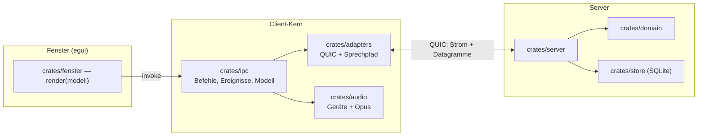

# Entwurf — das Ganze auf einem Blatt

Dieses Dokument beantwortet eine Frage: **gibt es für jede Funktion einen
Entwurf?** Ja — mit einer Ausnahme, die klar benannt ist (Abschnitt 9).

Legende: **✔ gebaut und geprüft** · **◐ entworfen, nicht gebaut** · **○ entschieden, bewusst nicht** · **✗ offen**

| Bereich | Stand | Wo der Entwurf steht |
|---|---|---|
| Transport (QUIC) | ✔ | `docs/adr/0003-quic-als-transport.md` |
| Verschlüsselung (Transport) | ✔ | `docs/adr/0002-verschluesselung.md` |
| Anmeldung (Ed25519-Beweis) | ✔ | `docs/adr/0002`, `crates/adapters` |
| Räume (flach, ohne Unterräume), Rollen, Rechte | ✔ | `SPEC.md` §5, ADR 0009 |
| Text (dauerhaft, Verlauf, Löschen), Ende zu Ende | ✔ | `SPEC.md` §6, `docs/adr/0012-alles-ende-zu-ende.md` |
| Prüfprotokoll | ✔ | `SPEC.md` §8 |
| Eingriffe: stumm, taub, verschieben, rauswerfen, trennen, sperren | ✔ | `docs/adr/0008-eingriffe-und-kontextmenues.md` |
| Sprache (verteilen, Recht, Kopf) | ✔ | `docs/adr/0003`, `crates/server` |
| Vorlauf, Jitter-Puffer, Sprechtaste | ✔ | `crates/adapters/src/sprechpfad.rs` |
| Geräte (cpal, Rückfall PipeWire) und Opus | ✔ | `docs/AUDIO.md`, `crates/audio` |
| Rauschunterdrückung (RNNoise), Noisegate | ✔ | `docs/AUDIO.md`, `crates/adapters/src/klang.rs` |
| Echounterdrückung (AEC3) | ✔ | `docs/AUDIO.md`, `crates/adapters/src/echo.rs` |
| Verlustausgleich (FEC + Paritätsrahmen) | ✔ | `crates/audio/src/verlust.rs` |
| Sprache Ende zu Ende, je Raum | ✔ | `docs/adr/0006-endezuende.md` |
| Fenster in reinem Rust (egui), Chat einklappbar | ✔ | `docs/adr/0013-alles-in-rust.md` |
| Verwaltung: Konsole und Server-Fenster | ✔ | `docs/adr/0013-alles-in-rust.md` |
| Reaktionen, Link-Vorschau | ✔ | `docs/adr/0012-alles-ende-zu-ende.md` (Stufe 2) |
| Betrieb (Docker, Sicherung, Export) | ✔ | `SPEC.md` §2, `README.md` |
| Pakete je System | ◐ (in der CI gebaut, auf echten Windows-/Mac-Geräten ungeprüft) | `packaging/`, `docs/adr/0013-alles-in-rust.md` |
| Video, Bildschirm | ◐ (bewusst später) | `docs/adr/0005-video-und-bildschirm.md` |
| Dateien im Chat | ◐ (entworfen, ADR 0012 Stufe 3; für das egui-Fenster neu zu bauen) | `docs/adr/0012-alles-ende-zu-ende.md` |
| Status, Suche | ○ (Version 1 nicht) | `SPEC.md` §3 |
| Skalierung über einen Prozess hinaus | ✗ | Abschnitt 9 |

---

## 1. Die drei Teile



Jede Kante hat eine Richtung, die nicht zurückläuft (AGENTS.md §3). Der
Server kennt kein Fenster, das Fenster keine Domäne, `domain` kein Netz.

## 2. Sprache: Weg und Zeitbudget

```text
Mikrofon → 48 kHz mono → 20-ms-Rahmen → [PTT/Vorlauf] → Opus 32 kbit/s
        → QUIC-Datagramm (6 Byte Kopf) → Server: Recht + Raum prüfen (≈16 µs)
        → QUIC-Datagramm → Jitter-Puffer (60 ms) → Opus-Decoder → Lautsprecher
```

| Abschnitt | Budget | gemessen/geschätzt |
|---|---|---|
| Aufnahme + Rahmenbildung | 20 ms | fest (Rahmenlänge) |
| Opus kodieren | 1–3 ms | ◐ |
| Client → Server | RTT/2 | LAN < 1 ms |
| Server prüfen + verteilen | **16 µs (p50), 30 µs (p99)** | ✔ gemessen |
| Server → Client | RTT/2 | LAN < 1 ms |
| Jitter-Puffer | 60 ms (einstellbar) | ◐ Startwert |
| Opus dekodieren | 1–3 ms | ◐ |
| Ausgabe | 20 ms | fest |
| **Summe LAN** | **≈ 110 ms** | Ziel < 150 ms |

TeamSpeak liegt mit Vorgabe (300 ms Push-to-Talk-Verzögerung) darüber. Unser
Vorlauf kostet 0 ms Zusatz, weil er **vor** dem Tastendruck mitläuft.

## 3. Text

Dauerhaft in SQLite (`nachrichten`), Verlauf je Raum, Gäste sehen nur ab ihrem
Betreten (`VerlaufLesen`). Löschen: Verfasser setzt Platzhalter, Moderator
löscht hart — beides protokolliert. Aufbewahrungsfrist optional
(`aufbewahrung_tage`).

Seit ADR 0012 Ende zu Ende: der Text liegt dauerhaft auf dem Server, aber nur
als Geheimtext mit einem Serverschlüssel, den die Mitglieder haben. Der Server
kann deshalb nicht mehr nach Inhalt suchen — Suche muss im Client laufen.
(Die frühere Abwägung „Text bleibt lesbar" in ADR 0006 ist damit überholt.)

## 4. Rechte

Vier Rollen, global, Tabelle im Programm (`crates/domain/src/role.rs`). Keine
Vererbung, keine Leistungsrechte, keine Negation. Sichtbarkeit folgt aus dem
Modell: `Zustand::darf_raeume_verwalten()` steuert, ob der Knopf erscheint.

## 5. Prüfprotokoll

Jede Zustandsänderung schreibt `(zeit, handelnder, aktion, ziel, vorher,
nachher, ergebnis)` — **auch Ablehnungen**. Lesbar für Administrator und
Moderator (`ProtokollLesen`). Kein Rückgängig, kein Abspielen (SPEC §8).

## 6. Betrieb

Ein Container, ein Volume, ein UDP-Port. Konfiguration aus Datei + Umgebung.
Sicherung nach Plan im Textformat (`format_version`), Export/Import als
Unterbefehl, `VACUUM INTO` für die Datenbank. Update: Migration beim Start,
vorher automatische Sicherung, kein Downgrade.

## 7. Fenster

Fünf Ansichten: Serverliste, Räume (Seitenleiste mit Räumen und Leuten,
Verlauf, Eingabe), Protokoll und Sperren (Tabellen), Einstellungen (Karten).
egui mit dem Bausatz aus `crates/oberflaeche`: Farben, Abstände und
Schriftgrade aus den Token-Dateien, drei Themes (ADR 0013).

## 8. Was bewusst **nicht** in Version 1 ist

Dateien, Status/Abwesenheit, Video, Bildschirmfreigabe, Suche.
(Reaktionen kamen mit ADR 0012 Stufe 2 dazu; Effekte gab es kurz und sind wieder entfallen.) Jedes hat einen Entwurf (§9 bzw. ADR 0005), aber keinen Platz in v1 —
weil „Struktur, die nicht verrottet" und „Betrieb, der beherrschbar ist" die
Zusage sind, nicht der Funktionsumfang.

## 9. Die eine offene Stelle: mehr als ein Prozess

Heute: ein Prozess, eine Sperre über den Zustand, einige hundert Verbundene.
Für einen Verein genügt das messbar. **Nicht entworfen** ist der Weg darüber
hinaus. Skizze, falls er gebraucht wird:

1. **Zustand teilen** — Kanäle, Rollen, Nachrichten in eine Datenbank mit
   Änderungsstrom (Postgres `LISTEN/NOTIFY` oder NATS); jeder Serverknoten hält
   einen Lesecache.
2. **Teilnehmer zuordnen** — ein Sprecher gehört zu genau einem Knoten; die
   Verteilung innerhalb eines Raums wird per Vermittlung zwischen Knoten
   gemacht (ein „Raum-Register").
3. **Sprachpfad** — Weiterleitung zwischen Knoten über dasselbe QUIC-Protokoll,
   nur mit Knoten als Gegenstelle (bereits möglich, weil Datagramme
   transportunabhängig sind).
4. **Sitzungsübernahme** — Verbindungsumzug (QUIC kann das) statt Neuanmeldung.

Aufwand: Wochen bis Monate, und er zwingt die Datenbank in eine Rolle, die sie
heute nicht hat. Deshalb: **erst messen, ob ein Knoten nicht reicht** (Ziel:
200 Sprechende in einem Raum, 1 000 Verbundene), dann bauen.
