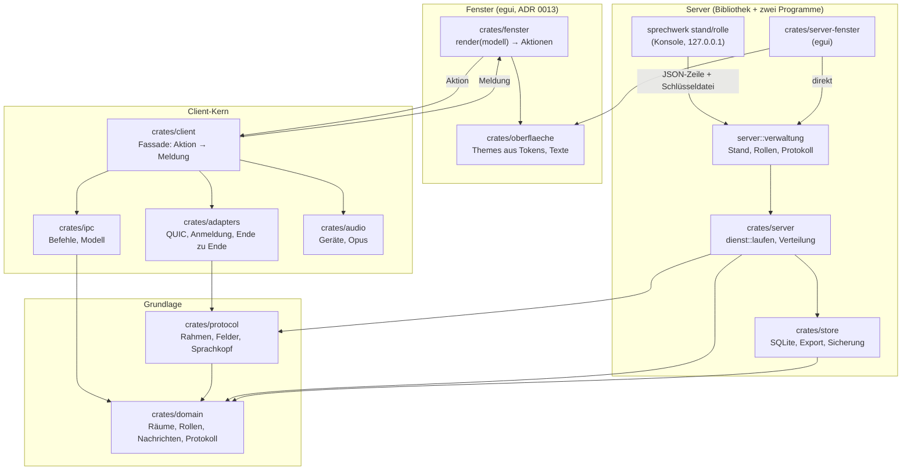

# Architektur

Ein Prozess für den Server, eine Fensteranwendung für den Menschen, dazwischen
ein Protokoll auf QUIC. Die Schichten sind streng: **jede Schicht kennt nur die
unter sich.**



## Grenzen

| Schicht | Darf | Darf nicht |
|---|---|---|
| `domain` | Regeln, Rechte, Zustandsübergänge | Netzen, Dateien, Zeit von außen holen |
| `protocol` | Bytes zu Feldern, Felder zu Bytes | Verbindungen aufbauen |
| `adapters` | QUIC, Schlüssel, Geräte | Fachlogik (Rechte, Räume) |
| `ipc` | Modell für die Oberfläche bauen | Fenster, Sockets |
| `client` | Aktionen ausführen, Zustand melden | zeichnen |
| `oberflaeche` | Themes, Texte, Bausteine | Netz, Client, Server kennen |
| `spielnetz` | Rahmen, Krypto, Vermittlung; Server- und Clientseite der zweiten QUIC-Verbindung | `Kern`, Räume, Rollen kennen (nur über `Mitgliedschaft`) |
| `fenster` | Modell zeichnen, Aktionen erzeugen, reine Logik in `logik.rs` | eigene Wahrheit über Server, Räume, Chat halten |
| `server::verwaltung` | Stand zeigen, Rollen als Betreiber setzen (ADR 0013) | Räume, Sperren, Konfiguration ändern |

Die wichtigste Zeile ist die des Fensters: es hat **einen** Zustand über den
Server, und der kommt vollständig aus dem Client-Kern (`crates/ipc::Zustand`).
Daneben hält es nur, was allein die Oberfläche betrifft (offene Ansicht,
offener Dialog, Text im Eingabefeld) — als Summentypen in `modell.rs`. Ein
Klick erzeugt eine `Aktion`; die Antwort ist ein neuer Modellstand.

## Warum der Server keinen Zustand doppelt hält

Räume, Rollen und Nachrichten liegen im Server in `domain`-Strukturen und werden
nach jeder Änderung in die Datenbank geschrieben (`crates/store`). Es gibt keine
zweite Wahrheit in der Query-Schicht oder im Fenster. Alles, was ein Client
sieht, ist eine Ansicht dieses einen Zustands.

## Spielnetz (ADR 0016)

Ein zweites Protokoll auf **demselben** UDP-Port, unterschieden am ALPN:
`sprechwerk/1` ist die Sitzung, `sprechwerk-spielnetz/1` das Spielnetz. Ist das
Modul aus (`[spielnetz] aktiv = false`, Vorgabe), wird der zweite ALPN nicht
angeboten, der Handschlag scheitert — und keine Zeile des Moduls läuft.

```text
Sitzung   sprechwerk/1              → Rechte, Räume, Sprache, Text
Spielnetz sprechwerk-spielnetz/1    → Freigaben, getunnelte Ströme/Datagramme
```

Die Grenze zum Serverkern ist ein Trait: `spielnetz::Mitgliedschaft::stand()`
liefert eine Momentaufnahme (Kennung, Name, Raum, `darf`), mehr weiß das Modul
nicht. Was daraus folgt, entscheidet `spielnetz::vermittlung::Vermittlung` —
ein Zustandsautomat ohne Netz, der Ereignisse hineinnimmt und Aktionen
zurückgibt. `spielnetz::server::Modul` führt diese Aktionen aus; der Kern wird
dafür nicht umgebaut, er bekommt nur nach jeder Änderung ein `anstossen()`.

Durch die Ströme und Datagramme geht ausschließlich Geheimtext (ADR 0012,
ADR 0016 §5): der Server sieht Köpfe und Mengen, nicht Inhalte.

### Im Client hängt das Modul neben der Sitzung

`crates/client/src/spielnetz.rs` (`Spielnetzbetrieb`) führt den Sollzustand:
Einstellung an/aus und „Sitzung steht“ (Serveradresse + angehefteter
Fingerabdruck). Beides kommt aus dem Modell, nicht aus einem zweiten Weg —
`abgleichen` wird nach jeder Zustandsmeldung und nach dem Speichern der
Einstellungen gerufen und tut nur etwas, wenn sich der Sollzustand geändert
hat (kein Endlos-Neuversuch bei einem Server ohne Modul). Der Sitzungsthread
(`anwendung.rs`) bleibt unverändert; angehängt ist das Modul an der Fassade
(`sitzung.rs`), und sein Stand liegt als `ipc::Spielnetz` im `Zustand`.

Drei Stände folgen direkt aus der Einstellung: `Aus` (Vorgabe, kein Port, keine
zweite Verbindung), `Wartet` (an, aber keine Sitzung) und `Verbindet`. Danach
sagt der Server: `NichtAngeboten` (Modul aus), `Abgelehnt` (kein Recht),
`Bereit` (mit den Freigaben des Raums) — oder es bleibt bei `Fehler`.

## Sprache

Sprache geht als QUIC-Datagramm daneben, nicht durch den Steuerstrom:

```text
[0] Version  [1] Codec  [2..3] Folge (je Sprecher)  [4..] Opus
```

Der Server prüft Rederecht und Raumzugehörigkeit (aus dem Sitzungszustand,
nicht aus dem Paket) und schickt das Datagramm an die anderen im Raum. Er
entschlüsselt die Toninhalte nicht, mischt nicht und speichert nicht.
