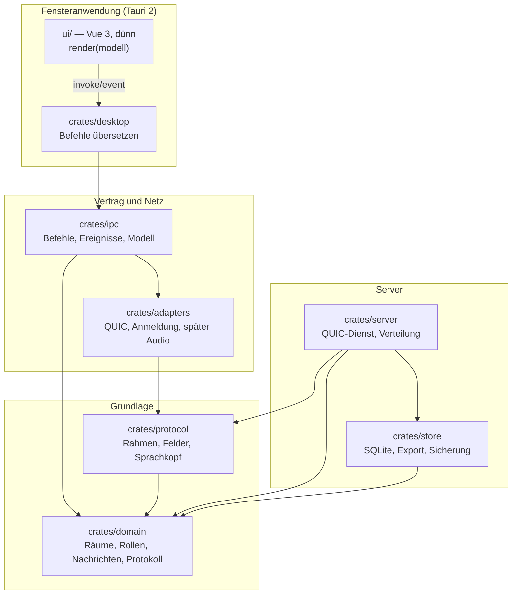

# Architektur

Ein Prozess für den Server, eine Fensteranwendung für den Menschen, dazwischen
ein Protokoll auf QUIC. Die Schichten sind streng: **jede Schicht kennt nur die
unter sich.**



## Grenzen

| Schicht | Darf | Darf nicht |
|---|---|---|
| `domain` | Regeln, Rechte, Zustandsübergänge | Netzen, Dateien, Zeit von außen holen |
| `protocol` | Bytes zu Feldern, Felder zu Bytes | Verbindungen aufbauen |
| `adapters` | QUIC, Schlüssel, Geräte | Fachlogik (Rechte, Räume) |
| `ipc` | Modell für die Oberfläche bauen | Fenster, Sockets |
| `desktop` | Befehle weiterreichen, Ereignisse senden | Rechnen |
| `ui` | Darstellen, Ereignisse auslösen | Eigene Wahrheit halten |

Die letzte Zeile ist die wichtigste: die Oberfläche hat **einen** Zustand, und
der kommt vollständig aus dem Rust-Teil (`crates/ipc::Zustand`). Ein Klick löst
einen Befehl aus; die Antwort ist ein neuer Modellstand.

## Warum der Server keinen Zustand doppelt hält

Räume, Rollen und Nachrichten liegen im Server in `domain`-Strukturen und werden
nach jeder Änderung in die Datenbank geschrieben (`crates/store`). Es gibt keine
zweite Wahrheit in der Query-Schicht oder im Fenster. Alles, was ein Client
sieht, ist eine Ansicht dieses einen Zustands.

## Sprache

Sprache geht als QUIC-Datagramm daneben, nicht durch den Steuerstrom:

```text
[0] Version  [1] Codec  [2..3] Folge (je Sprecher)  [4..] Opus
```

Der Server prüft Rederecht und Raumzugehörigkeit (aus dem Sitzungszustand,
nicht aus dem Paket) und schickt das Datagramm an die anderen im Raum. Er
entschlüsselt die Toninhalte nicht, mischt nicht und speichert nicht.
