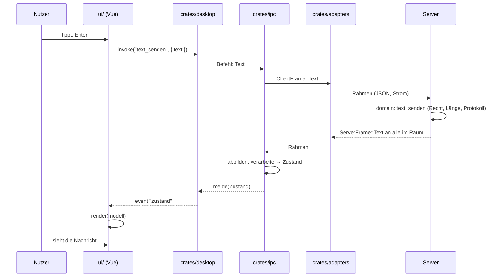

# Datenfluss: von der Tastatur zum Bild

## 1. Text schreiben



Der Rückweg über das Ereignis ist **kein** Umweg: der Absender bekommt seine
Nachricht vom Server zurück, damit die Zeit und die Reihenfolge stimmen, die der
Server vergeben hat.

## 2. Raum betreten

1. Klick auf einen Raum → `invoke("betreten", { raum })`.
2. Server prüft `RaumBetreten`, merkt sich den Raum, liefert den sichtbaren
   Verlauf (Gäste sehen nur, was seit ihrem Betreten geschrieben wurde).
3. `ServerFrame::Betreten { raum, verlauf, anwesen }`.
4. `abbilden::verarbeite` setzt `aktueller_raum`, `nachrichten`, `mitglieder`
   und markiert den Raum als `hier`.
5. Der Raum bekommt zusätzlich ein `Anwesenheit`-Rundruf an die anderen.

## 3. Sprache

```text
Client A: Opus-Rahmen + 4 Byte Kopf → QUIC-Datagramm
Server:   Kopf prüfen, Recht prüfen (Rollen), Raum aus dem Sitzungszustand
         → send_datagram an alle anderen im Raum (kein Puffer, kein Warten)
Client B: Kopf lesen, Jitter-Puffer, dekodieren, ausgeben
```

Verworfen wird bewusst: falscher Kopf, kein Rederecht, kein Raum, voller
Sendepuffer. Ein verspäteter Rahmen ist wertlos.

## 4. Verbindungsabbruch

`Verbindung::empfang()` endet oder meldet einen Fehler → `abbilden::getrennt`
setzt den Zustand auf `Fehler` (oder `Getrennt`), leert Mitglieder und Räume und
meldet den Stand. Das Fenster zeigt den Anmeldebildschirm mit der Meldung — es
gibt keinen halb verbundenen Zustand.
