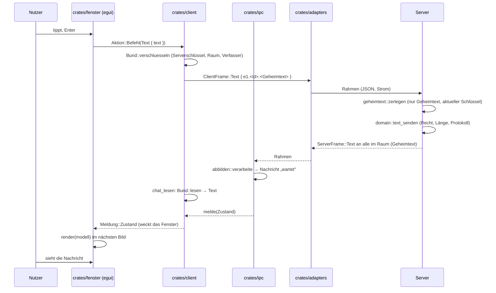
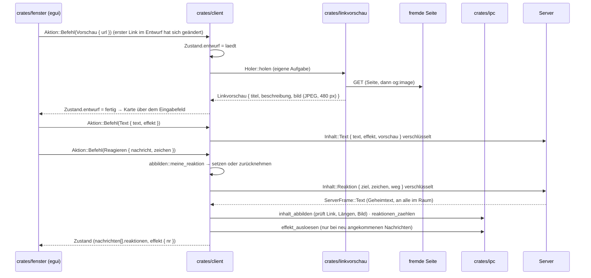

# Datenfluss: von der Tastatur zum Bild

## 1. Text schreiben



Ver- und entschlüsselt wird **im Client-Kern** (`crates/client`), nicht im
Server und nicht in der Oberfläche (ADR 0012). Der Server sieht nur die Hülle; die
Oberfläche bekommt nur das Ergebnis (`inhalt`: Text, wartet, unlesbar, …).
Fehlt der Schlüssel, bleibt eine Nachricht „wartet" und wird lesbar, sobald
ein Mitglied ihn weitergegeben hat — ohne den Verlauf neu zu laden.

### Reaktionen, Effekte, Link-Vorschau (ADR 0012, Stufe 2)

Alles läuft **denselben** Weg wie Text — der Server sieht nur Geheimtext und
weiß nicht, ob darin ein Text, eine Reaktion oder eine Vorschau steckt.



Nur der **Absender** ruft die Seite ab; Empfänger bekommen die fertige
Vorschau im Umschlag und fragen keine fremde Seite an. Reaktionen sind eigene
Umschläge, die der Client am Ziel zusammenfasst (`reaktionen_zaehlen`, rein,
jedes Mal aus dem ganzen Verlauf). Ein Effekt spielt, wenn `effekt.nr` sich
ändert — die Oberfläche braucht dafür keinen eigenen Zustand.

Der Rückweg über die Meldung ist **kein** Umweg: der Absender bekommt seine
Nachricht vom Server zurück, damit die Zeit und die Reihenfolge stimmen, die der
Server vergeben hat.

## 2. Raum betreten

1. Klick auf einen Raum → `Aktion::Befehl(betreten { raum })`.
2. Server prüft `RaumBetreten`, merkt sich den Raum, liefert den sichtbaren
   Verlauf (Gäste sehen nur, was seit ihrem Betreten geschrieben wurde).
3. `ServerFrame::Betreten { raum, verlauf, anwesen }`.
4. `abbilden::verarbeite` setzt `aktueller_raum`, `nachrichten`, `mitglieder`
   und markiert den Raum als `hier`.
5. Der Raum bekommt zusätzlich ein `Anwesenheit`-Rundruf an die anderen.

**Reihenfolge ist Teil des Vertrags.** Die Antwort `Betreten { anwesend }` ist
eine Momentaufnahme, und der Client **ersetzt** damit seine Mitgliederliste.
Eine Meldung über jemanden, der danach kam, muss deshalb auch danach
ankommen — sonst überschreibt die ältere Aufnahme die neuere Meldung, und der
Späterkommende fehlt dauerhaft (als Schlüsselwart: er bekommt nie einen
Raumschlüssel). Der Server sichert das, indem er Befehl ausführen und Antwort
ins Postfach legen **unter einer Sperre** erledigt (`crates/server/src/netz.rs`).
Geprüft am Draht: `gleichzeitiges_betreten_laesst_niemanden_verschwinden`
in `crates/server/tests/rundlauf.rs` (sechs Clients, zwölf Runden).

## 3. Sprache

```text
Client A: Opus-Rahmen + 6 Byte Kopf → QUIC-Datagramm
Server:   Kopf prüfen, Recht prüfen (Rollen), Raum aus dem Sitzungszustand
         → send_datagram an alle anderen im Raum (kein Puffer, kein Warten)
Client B: Kopf lesen, Jitter-Puffer, dekodieren, ausgeben
```

Verworfen wird bewusst: falscher Kopf, kein Rederecht, kein Raum, voller
Sendepuffer. Ein verspäteter Rahmen ist wertlos.

## 4. Verbindungsabbruch

`Verbindung::empfang()` endet oder meldet einen Fehler → `abbilden::getrennt`
setzt den Zustand auf `Fehler` (oder `Getrennt`), leert Mitglieder und Räume und
meldet den Stand. Das Fenster zeigt den Anmeldebildschirm mit der Meldung — es
gibt keinen halb verbundenen Zustand.
